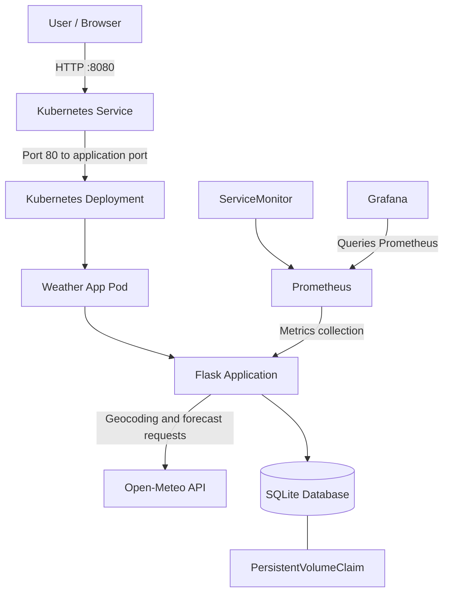
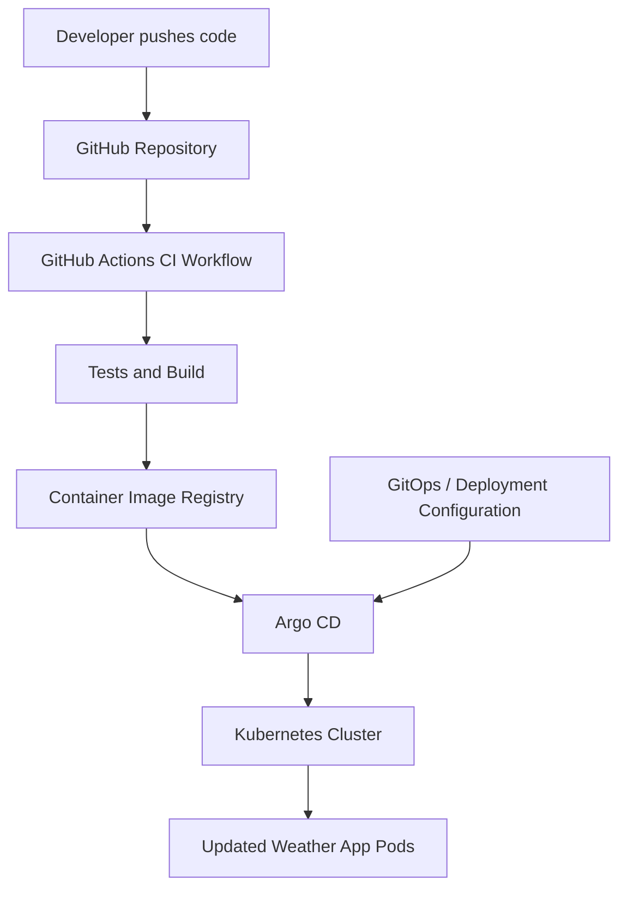
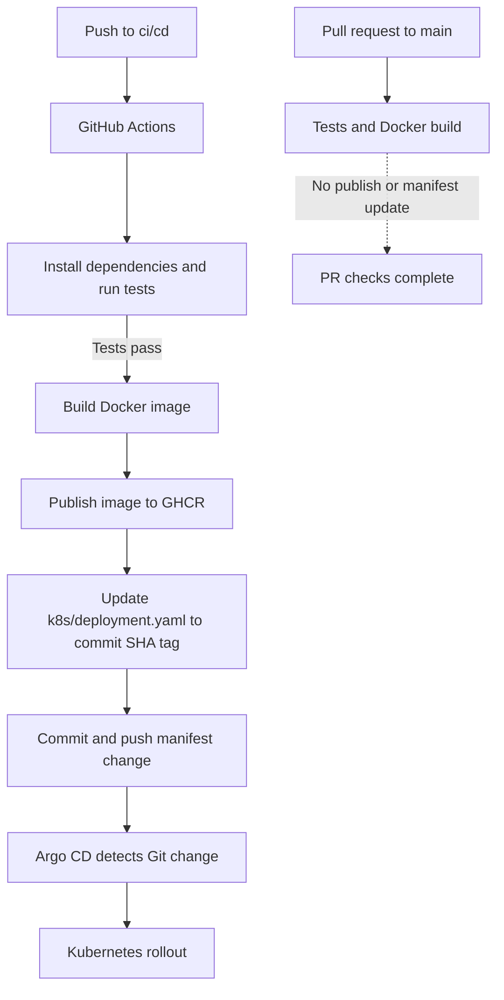

# Daybreak Weather — Cloud-Native DevOps Project

A Flask-based weather application enhanced with Docker, Kubernetes, GitHub Actions, Argo CD, Helm, Prometheus, and Grafana.

Daybreak Weather retrieves current weather conditions and a five-day forecast using the Open-Meteo API. It also maintains a history of successful city searches in SQLite.

This project extends the original application with containerization, Kubernetes deployment, persistent storage, automated delivery, GitOps-based synchronization, and monitoring.

## Table of Contents
- [Overview](#overview)
- [Features](#features)
- [Technology Stack](#technology-stack)
- [Architecture](#architecture)
- [Repository Structure](#repository-structure)
- [Application Setup](#application-setup)
- [Docker Setup](#docker-setup)
- [Kubernetes Deployment](#kubernetes-deployment)
- [Persistent Storage](#persistent-storage)
- [CI/CD Pipeline](#cicd-pipeline)
- [GitOps with Argo CD](#gitops-with-argo-cd)
- [Monitoring with Prometheus and Grafana](#monitoring-with-prometheus-and-grafana)
- [Verification and Troubleshooting](#verification-and-troubleshooting)
- [Security and Reliability](#security-and-reliability)
- [Known Limitations](#known-limitations)

## Overview
Daybreak Weather demonstrates how a small Python web application can be packaged, deployed, monitored, and maintained using modern DevOps practices.

The application is built with Flask and integrates with Open-Meteo for weather data. SQLite stores successful search history locally.

The DevOps implementation introduces:

- Docker for packaging the application and its dependencies.
- Kubernetes Deployment and Service resources for running and exposing the application.
- PersistentVolumeClaim for retaining application data across container restarts, subject to the configured storage and mount path.
- GitHub Actions for continuous integration and image delivery, according to the configured workflow.
- Argo CD for GitOps-based application synchronization and automated deployment updates.
- Helm for managing the monitoring stack's configuration.
- Prometheus and Grafana for collecting and visualizing operational metrics.
- ServiceMonitor for configuring Prometheus discovery of a compatible application metrics endpoint.

The Kubernetes environment can run locally, depending on the cluster and storage provisioner used.

## Features
### Application features
- Search for a city by name.
- Retrieve current weather conditions.
- Display a five-day forecast.
- Store up to five recent successful searches.
- Use Open-Meteo without an API key.
- Configure the SQLite database location and weather request timeout.

### DevOps features
- Containerized application deployment.
- Declarative Kubernetes configuration.
- Persistent storage configuration.
- Automated CI/CD workflow.
- GitOps-based deployment reconciliation.
- Helm-managed monitoring configuration.
- Prometheus metrics collection and Grafana visualization.

## Technology Stack
| Component               | Technology       |
| ----------------------- | ---------------- |
| Backend                 | Python, Flask    |
| Weather API             | Open-Meteo       |
| Database                | SQLite           |
| Containerization        | Docker           |
| Orchestration           | Kubernetes       |
| CI/CD                   | GitHub Actions   |
| GitOps                  | Argo CD          |
| Monitoring              | Prometheus       |
| Visualization           | Grafana          |
| Monitoring configuration | Helm             |
| Kubernetes manifests    | YAML, Kustomize  |

## Architecture
### 1. Overall system architecture


The diagram represents the intended logical architecture. The actual connections depend on the port mappings, PVC mount, metrics endpoint, ServiceMonitor selector, and monitoring configuration in your manifests.

### 2. CI/CD and GitOps architecture


The intended delivery process is:

1. A code change is pushed to the repository.
2. GitHub Actions executes the steps configured in `.github/workflows/ci.yml`.
3. The workflow performs the configured checks and builds the container image.
4. The image is published if the workflow is configured to push it to a registry.
5. Argo CD reconciles the Kubernetes application with the desired Git configuration.
6. The updated workload becomes available through the Kubernetes Service.

**Important:** This project updates the image tag in Git through the GitHub Actions workflow. Argo CD does not watch GHCR for new tags; it detects the Git manifest change and synchronizes the desired Kubernetes state.

## Repository Structure

The main project files are organized as follows:

```text
.
├── .github/
│   └── workflows/
│       └── ci.yml
├── k8s/
│   ├── deployment.yaml
│   ├── kustomization.yaml
│   ├── monitoring-values.yaml
│   ├── pvc.yaml
│   ├── service.yaml
│   └── servicemonitor.yaml
├── static/
│   └── style.css
├── templates/
│   └── index.html
├── tests/
│   └── test_app.py
├── app.py
├── argocd-weather-app.yaml
├── database.py
├── weather.py
├── Dockerfile
├── .dockerignore
├── .gitignore
├── requirements.txt
└── README.md
```

The Argo CD manifest is shown with a descriptive filename; retain the exact filename present in your repository.

| File                         | Purpose                                                              |
| ---------------------------- | -------------------------------------------------------------------- |
| `app.py`                     | Flask application and request handling                               |
| `weather.py`                 | Weather API integration                                              |
| `database.py`                | SQLite database initialization and operations                       |
| `tests/test_app.py`          | Application tests                                                    |
| `Dockerfile`                 | Container image definition                                           |
| `.dockerignore`              | Excludes unnecessary files from the Docker build context             |
| `ci.yml`                     | GitHub Actions pipeline configuration                                |
| `deployment.yaml`            | Kubernetes workload configuration                                    |
| `service.yaml`               | Internal application networking                                      |
| `pvc.yaml`                   | Persistent storage claim                                             |
| `servicemonitor.yaml`        | Prometheus target discovery configuration                            |
| `monitoring-values.yaml`     | Helm values for the monitoring installation                          |
| `kustomization.yaml`         | Groups Kubernetes resources for Kustomize                             |
| Argo CD Application manifest | Defines the Git source and destination cluster configuration          |

## Application Setup
### Prerequisites
For local development, install:

- Python 3.9 or newer.
- pip and Python virtual environment support.
- An internet connection for weather lookups.

Clone the repository:

```bash
git clone https://github.com/Medha170/weather-app.git
cd weather-app
```

Create and activate a virtual environment:

```bash
python3 -m venv .venv
source .venv/bin/activate
```

Install dependencies:

```bash
pip install -r requirements.txt
```

Start the Flask application:

```bash
python app.py
```

Open the application at:

http://127.0.0.1:5001

## Docker Setup
Docker packages the Flask application and its Python dependencies into a container image, making the application easier to run consistently across environments.

### Build the image
From the project root:

```bash
docker build -t weather-app:latest .
```

Verify that the image exists:

```bash
docker images
```

### Run the container
```bash
docker run --rm \
     --name weather-app \
     -p 5001:5001 \
     weather-app:latest
```

Open:

http://127.0.0.1:5001

### Verify the container
```bash
docker ps
docker logs weather-app
```

Stop a running container when it is not running with `--rm`:

```bash
docker stop weather-app
```

For local development, the database can be persisted using a mounted volume. The mount destination must match the database path configured in the application and container.

## Kubernetes Deployment
Kubernetes manages the application's desired replica count, pod lifecycle, networking, and declarative configuration.

### Prerequisites
Install or configure:

- `kubectl`
- A running Kubernetes cluster, such as Minikube or kind.
- A compatible storage provisioner if dynamic persistent storage is required.
- A container image accessible to the cluster.
- Docker, if you need to build the image locally.

Verify the cluster:

```bash
kubectl cluster-info
kubectl get nodes
```

### Step 1: Build and make the image available
For a local cluster that shares Docker's image store, build the image:

```bash
docker build -t weather-app:latest .
```

If using kind:

```bash
kind load docker-image weather-app:latest
```

For a remote cluster, push the image to your configured registry and ensure the Deployment references the published image. Private registries may require an image pull secret.

### Step 2: Apply the Kubernetes manifests
From the project root:

```bash
kubectl apply -k k8s/
```

This uses `kustomization.yaml` to apply the resources listed in it. Verify that it includes the Deployment, Service, PVC, and any other resources you intend to deploy.

Alternatively, if you are applying resources individually and the manifests do not depend on additional configuration:

```bash
kubectl apply -f k8s/pvc.yaml
kubectl apply -f k8s/deployment.yaml
kubectl apply -f k8s/service.yaml
```

Use one deployment method consistently. Do not apply a resource twice using different, conflicting configurations.

### Step 3: Check deployment status
```bash
kubectl get deployments
kubectl get pods -o wide
kubectl get services
kubectl get pvc
```

Inspect the Deployment:

```bash
kubectl describe deployment weather-app-deployment
```

Inspect application logs:

```bash
kubectl logs deployment/weather-app-deployment
```

If pods are not starting, inspect their events and status:

```bash
kubectl describe pod weather-app
kubectl get events --sort-by=.metadata.creationTimestamp
```

### Step 4: Access the application
Forward local port `8080` to port `80` on the Kubernetes Service:

```bash
kubectl port-forward svc/weather-app-service 8080:80
```

Keep this terminal running while testing the application.

Open:

http://127.0.0.1:8080

The mapping is:

```text

Browser: localhost:8080

           |

           v

Kubernetes Service: port 80

           |

           v

Application Pod: configured target port

```

The port-forward command exposes the Service locally; it does not create a public internet endpoint.

## Persistent Storage
The application uses SQLite to store successful city searches. Kubernetes pods have replaceable lifecycles, so relying solely on a container's writable filesystem can result in data loss when a pod is replaced.

The `pvc.yaml` manifest requests persistent storage, while the Deployment should mount the resulting volume at the database directory or file path used by the application.

### Check storage status
```bash
kubectl get pvc
kubectl describe pvc weather-app-claim
```

A PVC in `Bound` state indicates that a volume has been allocated to the claim.

Inspect the Deployment's volume configuration:

```bash
kubectl describe deployment weather-app-deployment
```

**Storage considerations:**

- The database path configured by `WEATHER_DATABASE` must match the mounted storage location.
- SQLite requires appropriate filesystem permissions.
- A PVC provides persistence only when the volume is mounted correctly and its underlying storage survives pod replacement.
- Multiple replicas sharing a SQLite database can introduce concurrency and filesystem limitations. A single replica is a simpler deployment model for this application.
- Local storage may not survive deletion of the local cluster or its underlying volumes.

## CI/CD Pipeline
The workflow at `.github/workflows/ci.yml` automates testing, Docker image delivery, and updating the Kubernetes Deployment manifest. It publishes images to GitHub Container Registry (GHCR) and commits the new image reference back to the `ci/cd` branch for Argo CD to reconcile.

### Workflow triggers

- **Push to `ci/cd`:** runs tests, builds the Docker image, publishes it to GHCR, and updates `k8s/deployment.yaml` with the commit-specific image tag.
- **Pull request targeting `main`:** runs the test and build jobs, but does not publish an image or update the deployment manifest because those steps are restricted to `push` events.

### Pipeline stages

1. **Checkout:** checks out the repository source using `actions/checkout`.
2. **Set up Python:** configures Python 3.13 and pip caching.
3. **Install dependencies:** upgrades pip and installs packages from `requirements.txt`.
4. **Run tests:** executes `python -m unittest discover -s tests -v`. The Docker job depends on this job, so it starts only after the tests pass.
5. **Build the image:** builds the Docker image from the repository root using `docker/build-push-action`.
6. **Publish to GHCR:** on pushes to `ci/cd`, authenticates with `GITHUB_TOKEN` and publishes `ghcr.io/medha170/weather-app` with two tags: a short commit SHA tag (`sha-<7-character-SHA>`) and the moving `ci-cd` tag.
7. **Update the Kubernetes manifest:** on pushes to `ci/cd`, rewrites the image reference in `k8s/deployment.yaml` to the new commit-specific `sha-<7-character-SHA>` tag. The workflow commits and pushes that change using the GitHub Actions bot identity. If the manifest already references the image, it reports that no update is needed.
8. **Deploy through GitOps:** Argo CD watches the configured Git revision. Once it sees the manifest commit, it reconciles the Kubernetes resources and Kubernetes rolls out the updated image.

### Pipeline flow



### Run the tests locally

```bash
python -m unittest discover -s tests -v
```

The tests use a temporary SQLite database and mock weather API behavior, so they do not require a live Open-Meteo request.

### Verify the pipeline

After pushing a change to `ci/cd`:

1. Open the repository's **Actions** tab and confirm the workflow run succeeds.
2. Check the GHCR package for both the short-SHA tag and the `ci-cd` tag.
3. Inspect the workflow commit that updates `k8s/deployment.yaml` and confirm it references the new `sha-<7-character-SHA>` image tag.
4. Check Argo CD and confirm the application is synchronized and healthy.
5. Confirm the Kubernetes Deployment rolls out the expected image:

   ```bash
   kubectl get deployment weather-app-deployment -o jsonpath='{.spec.template.spec.containers[0].image}{"\n"}'
   kubectl rollout status deployment/weather-app-deployment
   kubectl get pods -o wide
   ```
The workflow uses `GITHUB_TOKEN` for GHCR authentication and to push the manifest update. The `docker-build` job therefore grants `packages: write` and `contents: write`. Do not put registry passwords or personal access tokens in the repository. The `[skip ci]` commit message on the generated manifest commit prevents the manifest-only update from starting another CI run.
## GitOps with Argo CD
Argo CD implements GitOps by comparing the desired application state stored in Git with the live Kubernetes resources.
The repository includes an Argo CD application manifest for the weather application. The exact Git repository URL, target revision, path, namespace, and synchronization options should be taken from that manifest.
### Architecture
```text

Git repository

        |

        v

Argo CD Application

        |

        v

Compare desired and live state

        |

        v

Synchronize Kubernetes resources

        |

        v

Deployment rollout

        |

        v

Running application

```

### Inspect Argo CD
If Argo CD is installed in the `argocd` namespace:

```bash
kubectl get pods -n argocd
kubectl get applications -n argocd
```

The Argo CD CLI can also be used if installed and configured:

```bash
argocd app list
argocd app get weather-app
```

To inspect the Application resource directly:

```bash
kubectl get application -n argocd
kubectl describe application weather-app -n argocd
```

### Automated CI/CD and Image Updates
The GitHub Actions workflow in `.github/workflows/ci.yml` automates testing and container image delivery.

On pushes to the `ci/cd` branch, the workflow:

1. Checks out the repository and installs Python dependencies.
2. Runs the unit tests using `unittest`.
3. Builds the Docker image.
4. Publishes the image to GitHub Container Registry (GHCR) with a commit-specific tag and the `ci-cd` tag.
5. Updates `k8s/deployment.yaml` to reference the newly published commit-specific image and pushes the manifest change to Git.

Argo CD monitors the configured Git revision and synchronizes the Kubernetes resources according to the application's sync policy. Kubernetes then rolls out the image referenced by the Deployment.

Pull requests targeting `main` run the checks configured for that event. Image publishing and deployment-manifest updates are restricted to push events.

### Verify a rollout
```bash
kubectl rollout status deployment/weather-app-deployment
kubectl get pods -o wide
kubectl describe deployment weather-app-deployment
```

Argo CD synchronization status and Kubernetes rollout health are related but distinct: a synchronized application can still have unhealthy pods.

## Monitoring with Prometheus and Grafana
Prometheus and Grafana provide monitoring and visualization for the Kubernetes environment and application, subject to the metrics exposed and scrape configuration installed.

Prometheus collects metrics from configured targets. Grafana queries Prometheus and displays the collected data in dashboards.

### Monitoring architecture
```text

Weather application

          |

          v

Metrics endpoint

          |

          v

ServiceMonitor

          |

          v

Prometheus

          |

          v

Grafana dashboards

```

The `servicemonitor.yaml` resource configures target discovery when its labels, namespace selection, Service selector, and endpoint settings match the installed Prometheus configuration.

The `monitoring-values.yaml` file contains Helm values used to configure the monitoring installation.

### Install the monitoring stack
This project uses the Prometheus Community `kube-prometheus-stack` chart.

Add the chart repository:

```bash
helm repo add prometheus-community \
     https://prometheus-community.github.io/helm-charts
helm repo update
```

Create a monitoring namespace if needed:

```bash
kubectl create namespace monitoring
```

Install or upgrade the chart using your project's values file:

```bash
helm upgrade --install monitoring \
     prometheus-community/kube-prometheus-stack \
     --namespace monitoring \
     --create-namespace \
     -f k8s/monitoring-values.yaml
```

### Verify monitoring components
```bash
helm list -A
kubectl get pods -n monitoring
kubectl get services -n monitoring
kubectl get servicemonitors -A
```

The namespace and release names must match your installation.

### Access Grafana
If the Grafana Service is named `monitoring-grafana` in the `monitoring` namespace, use:

```bash
kubectl port-forward -n monitoring \
     svc/monitoring-grafana 3000:80
```

Open:

http://127.0.0.1:3000

If your Service has a different name or port, obtain its actual values with:

```bash
kubectl get svc -n monitoring
```

Retrieve the initial administrator password only if the chart uses the conventional Kubernetes Secret and key:

```bash
kubectl get secret -n monitoring monitoring-grafana \
     -o jsonpath="{.data.admin-password}" | base64 --decode
echo
```

The Secret name and key depend on your Helm release and values. Do not publish passwords in the README or commit them to Git.

### Access Prometheus
The Prometheus Service is named `monitoring-kube-prometheus-prometheus`, use:

```bash
kubectl port-forward -n monitoring \
     svc/monitoring-kube-prometheus-prometheus 9090:9090
```

Open:

http://127.0.0.1:9090

Check the Prometheus Targets page to confirm that configured targets are being scraped successfully.

### Metrics and dashboard verification
Monitoring is useful only when the relevant metrics are available and targets are healthy.

Verify the following:

- Once the exporter and `/metrics` endpoint are implemented, verify that the application exposes the path configured in the ServiceMonitor.
- The ServiceMonitor selector matches the application's Kubernetes Service labels.
- The Prometheus installation discovers the ServiceMonitor.
- The target is listed as healthy in Prometheus.
- Grafana uses the appropriate Prometheus data source.
- Dashboard queries refer to metrics that are actually available.

The application-level exporter and `/metrics` endpoint are not implemented yet. Until they are added and verified, the ServiceMonitor cannot successfully scrape application metrics; the monitoring stack can still collect metrics from its other configured targets. Do not claim weather-request latency, successful searches, or API error metrics until those metrics are instrumented and observed.

## Verification and Troubleshooting
### Application returns an error
```bash
kubectl get pods
kubectl logs deployment/weather-app-deployment
kubectl describe pod weather-app
```

Check the Flask logs, container port, readiness settings, and Open-Meteo connectivity.

### Image pull errors
```bash
kubectl describe pod weather-app
kubectl get events --sort-by=.metadata.creationTimestamp
```

Check the image name and tag, registry permissions, and whether the image is accessible to the cluster.

### PVC is pending
```bash
kubectl get pvc
kubectl describe pvc weather-app-claim
kubectl get storageclass
```

Check the StorageClass, provisioner, requested capacity, access modes, and local cluster storage configuration.

### Port-forward fails
```bash
kubectl get svc weather-app-service
kubectl get pods
kubectl describe svc weather-app-service
```

Confirm that the Service selector matches the application pods and that its port and target port are correct.

### Argo CD does not deploy the new image
```bash
argocd app get weather-app
kubectl describe deployment weather-app-deployment
```

Check whether a new image was published, whether the desired image reference changed, and whether Argo CD has synchronized the updated configuration.

### Prometheus cannot find the application
```bash
kubectl get servicemonitors -A
kubectl get svc -A
kubectl get endpoints -A
```

Check namespace discovery, selectors, endpoint ports, and the application's metrics path.

## Security and Reliability
The following practices are relevant to the deployment:

- Keep registry credentials, access tokens, and other secrets outside source control.
- Avoid enabling Flask's development debugger in a public environment.
- Restrict access to Grafana, Prometheus, and Argo CD.
- Expose only the network endpoints required by the application.
- Use resource requests and limits appropriate to observed workload needs.
- Configure suitable health probes and verify their behavior before relying on automated restarts or rollouts.
- Use immutable image tags or digests where possible to make deployments reproducible.
- Preserve the Git history needed to trace changes from source to deployed version.
- Test recovery behavior and database persistence instead of assuming they work from the presence of YAML files alone.

## Known Limitations
- **Local Kubernetes environment:** The project is designed to run on a local Kubernetes cluster. Availability and persistence depend on the cluster and its storage provisioner.
- **SQLite:** The application uses SQLite and a single replica. This is appropriate for the demonstration but is not intended for high-concurrency, multi-replica production workloads.
- **Monitoring:** Prometheus can report failures for some local Kubernetes control-plane scrape targets when those endpoints are not accessible in the kind cluster. Application metrics should be evaluated separately from those infrastructure targets.
- **External API dependency:** Weather lookups require connectivity to Open-Meteo. An external API failure can affect weather retrieval even when the application itself is healthy.

These limitations describe the current deployment and do not necessarily indicate a failure of the application.

## Conclusion
Daybreak Weather combines a small Flask application with a cloud-native deployment and operations workflow. Docker provides consistent packaging, Kubernetes manages the running workload, persistent storage supports search-history retention, GitHub Actions automates configured delivery steps, Argo CD reconciles deployment state, and Prometheus/Grafana support monitoring.

The project demonstrates the progression from application development to deployment, observation, and operational verification.
